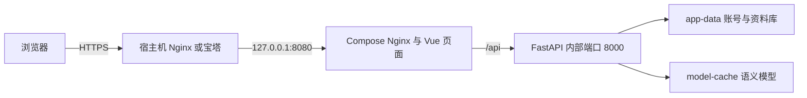

# Magical Video Docker 部署教程

浏览器通过 HTTPS 域名访问宿主机 Nginx 或宝塔反向代理。宿主机代理把页面和 `/api` 一起转发到 `127.0.0.1:8080`。Compose 内的 Nginx 提供 Vue 页面，并将 API 请求转发给内部的 FastAPI。首次部署前可以先按[本地开发计划](./长期记忆与课程Wiki-本地开发计划.md)验收业务流程。



## 1. 准备服务器

- 在 Linux 服务器安装 Git、Docker Engine 和 Compose 插件。运行 `docker version` 和 `docker compose version` 确认客户端能连接 Docker。当前配置的依赖服务重启字段要求 Compose 2.17 或更新版本。[Docker Engine 安装文档](https://docs.docker.com/engine/install/) · [Compose 插件安装文档](https://docs.docker.com/compose/install/linux/)
- 将域名解析到服务器，在宿主机或宝塔站点配置可自动续期的 TLS 证书。公网防火墙放行网站需要的 TCP 80 和 443，SSH 端口按自己的运维配置开放。
- 按单台 2 核 4 GB 服务器准备。保持一个后端实例和一个 Uvicorn worker 使用这份 SQLite 数据卷。还需留出构建镜像、缓存语义模型和下载临时文件的磁盘空间。
- 准备一个可从服务器访问的 AI 服务账号。DeepSeek、OpenAI 和 OpenCode Go 中选一家即可开始做分析与问答。

## 2. 获取代码和配置

```bash
git clone --branch main https://github.com/1211joker/Magical-Video.git
cd Magical-Video
install -m 600 backend/.env.example backend/.env
vi backend/.env
```

已有部署继续使用自己的 `backend/.env`。把示例域名换成用户在浏览器打开的 HTTPS 地址，有非标准端口时也要写上端口。填写所用模型服务的密钥，并设置两级正整数 AI 日额度。

```dotenv
SITE_ORIGIN=https://video.example.com
AUTH_AI_ACCOUNT_DAILY=30
AUTH_AI_SITE_DAILY=300
DEEPSEEK_API_KEY=填写自己的密钥
```

使用其他服务时，在同一文件填写 `OPENAI_API_KEY` 或 `OPENCODE_GO_API_KEY` 和所需模型配置。额度按上游 AI 请求计量，每天香港时间 08:00 恢复。从[环境变量示例](../backend/.env.example)查看支持的字段。

`MAGICAL_HTTP_PORT` 由 Compose 读取。若宿主机的 8080 已被占用，可在项目根目录的 `.env` 设置 `MAGICAL_HTTP_PORT=8081`，并把宿主反向代理的上游一起改为 `http://127.0.0.1:8081`。`SITE_ORIGIN` 仍填写浏览器访问的 HTTPS 域名。

## 3. 构建并等待服务就绪

在项目根目录运行以下命令。

```bash
docker compose config --quiet
docker compose up -d --build --wait --wait-timeout 180
docker compose ps
curl -fsS http://127.0.0.1:8080/api/health
```

`backend` 和 `nginx` 都应显示 `healthy`。后端通过健康检查后，Compose 才启动前端 Nginx。最后一条命令应返回包含 `"status":"ok"` 的 JSON。回环地址供宿主代理和健康检查使用，生产登录从 HTTPS 域名进入。

账号、会话和个人资料保存在 `app-data` 卷。`model-cache` 卷缓存课程检索需要的语义模型。需要在启动前预热模型时，先构建后端镜像，再运行准备命令。

```bash
docker compose build backend
docker compose run --rm --no-deps backend python -m services.study_embeddings --prepare
```

语义模型访问受限或测试机器资源紧张时，可在 `backend/.env` 设置 `STUDY_SEMANTIC=0`，使用全文检索。修改该文件后运行 `docker compose up -d --wait --wait-timeout 180` 加载新配置。

## 4. 配置 HTTPS 入口

宝塔用户先为域名创建站点、启用证书和 HTTP 跳转 HTTPS，再把反向代理的目标设为 `http://127.0.0.1:8080`。在站点配置里核对下面 `location /` 的转发头和 SSE 设置。已经由面板生成的 `server` 配置直接修改对应的代理段。

使用宿主机 Nginx 时，可用下面的站点配置。将示例域名和证书路径换成实际值。

```nginx
server {
    listen 80;
    server_name video.example.com;
    return 301 https://$host$request_uri;
}

server {
    listen 443 ssl;
    server_name video.example.com;
    ssl_certificate /path/to/fullchain.pem;
    ssl_certificate_key /path/to/privkey.pem;

    location / {
        proxy_pass http://127.0.0.1:8080;
        proxy_http_version 1.1;
        proxy_set_header Host $http_host;
        proxy_set_header X-Real-IP $remote_addr;
        proxy_set_header X-Forwarded-For $remote_addr;
        proxy_set_header X-Forwarded-Proto $scheme;
        client_max_body_size 10m;
        proxy_read_timeout 300s;
        proxy_buffering off;
    }
}
```

一般的 Linux Nginx 安装可执行 `sudo nginx -t`，检查通过后运行 `sudo systemctl reload nginx`。宝塔用户用面板的配置检查和重载入口。`Host` 会保留域名及端口，`X-Forwarded-Proto` 会告诉后端用户走的是 HTTPS。宿主机覆盖 `X-Forwarded-For`，容器 Nginx 信任固定 Compose 网关，Uvicorn 只信任容器 Nginx 的地址。若变更 Compose 网段，同步核对容器 Nginx 的网关和 Compose 中的 Nginx 地址。[nginx.conf](../nginx.conf) · [Compose 配置](../docker-compose.yml)

```bash
curl -fsS https://video.example.com/api/health
curl -sS -o /dev/null -w '%{http_code}\n' https://video.example.com/api/study/library
```

公网健康检查应返回 `200`。第二条命令会以未登录状态访问资料库，预期返回 `401`。

## 5. 注册、管理员和功能验收

1. 在 HTTPS 域名打开网站，选择「登录 → 注册账号」。填写用户名和站内密码，注册成功后会进入资料库。注册得到普通账号。
2. 需要管理员角色时，先注册目标账号，再在服务器的项目目录运行下方命令。重新进入账户菜单可以看到「管理员」标记。当前版本提供角色设置和展示。
3. 用一个有字幕的公开视频验证解析、入库及连续追问。另开浏览器会话使用同一账号，检查课程、视频和历史能否读回。再注册一个独立测试账号，确认资料相互隔离。
4. 原站点使用 Basic Auth 时，可在测试域名完成验证后，再将正式入口切到站内登录。

```bash
docker compose exec backend python -m maintenance promote-admin --username site_admin
```

## 6. 备份和版本升级

### 备份账号和资料库

安排短维护窗口，暂停后端再运行备份。按实际服务器权限创建备份目录。

```bash
backup_root=/srv/magical-video-backups
sudo install -d -m 700 "$backup_root"
snapshot_name="accounts-$(date -u +%Y%m%dT%H%M%SZ)"
docker compose stop backend
docker compose run --rm --no-deps -v "$backup_root:/backups" backend \
  python -m maintenance backup "/backups/$snapshot_name"
docker compose up -d --wait --wait-timeout 180
```

检查快照中的 `accounts.sqlite3` 和 `users/` 下的个人库。后端以容器用户写入文件，必要时用 `sudo ls` 查看。即使备份报错，也执行最后一行恢复服务。把可用的快照和对应 Git 版本记在一起，并保留加密的异机备份。`backend/.env` 含模型凭证，由运维单独保管。

新版快照可直接从只读挂载恢复。导入或恢复时，从停止写入的备份副本读取。旧版冷备份如果包含 SQLite 的 WAL 文件，应将这些文件与数据库一起保留，恢复工具会在可写的临时副本上读取日志中的已提交内容。[SQLite 只读数据库说明](https://sqlite.org/wal.html#read_only_databases)

### 从已有版本升级

现有版本已经使用账号库时，先完成上面的快照，再按顺序更新。SQLite 账号库在启动时自动升级，原账号 ID 对应的个人库继续使用。旧邮箱账号可以把原邮箱填在用户名栏，使用原站内密码登录。

```bash
git rev-parse --short HEAD
git pull --ff-only origin main
docker compose config --quiet
docker compose up -d --build --wait --wait-timeout 180
docker compose ps
```

升级后核对旧账号登录和资料内容。需要回滚时，用升级前的代码或镜像配合相同版本的快照与代理配置恢复服务，并保留升级后的数据卷供核对。

### 导入单用户旧资料库

升级前先保留旧库。若旧 Compose 将资料存在容器内部的 `/app/.study-data`，在旧版本目录先停后端并复制这整个目录，连同 SQLite 可能使用的 WAL 文件一起保留。已挂载到宿主机的旧库可使用停机副本或 SQLite 备份。

```bash
backup_root=/srv/magical-video-backups
legacy_dir="$backup_root/legacy-$(date -u +%Y%m%dT%H%M%SZ)"
sudo install -d -m 700 "$legacy_dir"
sudo docker compose stop backend
sudo docker compose cp backend:/app/.study-data/. "$legacy_dir"
```

新版本启动后，先注册一个空账号。将上一步备份目录只读挂载到维护容器，再导入 `library.sqlite3`。

```bash
docker compose stop backend
docker compose run --rm --no-deps -v "$legacy_dir:/transfer:ro" backend \
  python -m maintenance import-library /transfer/library.sqlite3 --username learner_demo
docker compose up -d --wait --wait-timeout 180
```

用目标账号登录检查视频、课程、Wiki 和问答历史。已使用的账号需要另选空账号承接旧库。

## 7. 从快照恢复到新数据卷

将 `snapshot_name` 设为实际备份目录名。维护命令会在新卷的 `data` 子目录恢复数据，并撤销旧会话。

```bash
backup_root=/srv/magical-video-backups
snapshot_name=替换为实际快照目录名
export MAGICAL_RECOVERY_VOLUME="magical-video-recovery-$(date -u +%Y%m%dT%H%M%SZ)"
docker volume create "$MAGICAL_RECOVERY_VOLUME"
docker compose run --rm --no-deps -v "$backup_root:/backups:ro" \
  -v "$MAGICAL_RECOVERY_VOLUME:/recovered" backend \
  python -m maintenance --data-dir /recovered/data restore "/backups/$snapshot_name"
```

保存下面的覆盖配置到仓库以外，例如 `$HOME/magical-video-recovery.yml`。它把刚恢复的卷挂在 `/data`，并将后端的数据目录设为对应子目录。

```yaml
services:
  backend:
    environment:
      STUDY_DATA_DIR: /data/data
volumes:
  app-data:
    external: true
    name: ${MAGICAL_RECOVERY_VOLUME:?Set MAGICAL_RECOVERY_VOLUME}
```

优先在独立测试环境验证恢复结果。确认要切换时，在服务器的项目目录运行以下命令。原数据卷仍可用于切回，后续管理恢复实例时沿用相同覆盖文件和卷名。

```bash
recovery_file="$HOME/magical-video-recovery.yml"
docker compose -f docker-compose.yml -f "$recovery_file" config --quiet
docker compose -f docker-compose.yml -f "$recovery_file" up -d --wait --wait-timeout 180
```

恢复后重新登录两个测试账号，检查各自资料、历史与管理员标记。需切回原数据卷时，用默认配置执行 `docker compose up -d --wait --wait-timeout 180`。保留数据的停机与重建使用 `docker compose stop` 或普通的 `docker compose down`。`docker compose down -v` 会删除项目管理的数据卷。

## 8. 常见问题

| 现象 | 如何检查 |
| --- | --- |
| 容器未就绪或公网返回 `502` | 先看 `docker compose ps` 和 `docker compose logs --tail=100 backend nginx`。本机健康检查正常后，核对宿主代理的目标地址 |
| 登录报 `403 invalid_origin` | 比对浏览器地址、实际请求的 `Origin`、`Referer` 与 `SITE_ORIGIN`。普通 Chrome 异常时，可查修改请求头的扩展。[Page Assist 排查记录](./长期记忆与课程Wiki-本地开发计划.md) |
| 登录后仍返回 `401` | 确认浏览器通过 HTTPS 域名进入，保存了站点会话 Cookie，并检查宿主代理传递的协议和主机名 |
| `8080` 已被占用 | 在根目录 `.env` 修改 `MAGICAL_HTTP_PORT`，重新启动 Compose，并同步宿主代理的目标端口 |
| 模型或 YouTube 请求失败 | 在服务器核对模型密钥和外网连通性。可设置后端容器可达的 `YTDLP_PROXY`。容器中的 `127.0.0.1` 指向后端容器自身 |
| 收到 `429` | 根据响应提示区分请求频率和 AI 日额度。应用会在额度用完时显示恢复时间 |

## 本机 Compose 验证（2026-11-28）

| 项目 | 实测结果 |
| --- | --- |
| 镜像和就绪 | 在本机隔离的 ARM64 Linux Docker 引擎中构建镜像，`backend` 和 `nginx` 均达到 `healthy`。回环端口可调健康接口 |
| HTTPS 与账号 | 使用教程中的宿主机 Nginx 代理规则和本机测试证书。验证用户名注册和登录、生产 Cookie 属性、管理员设置及两个账号的资料隔离。跨来源写请求返回 `403`，未登录访问资料库返回 `401` |
| 数据持久化 | 重建两个容器后，同一账号可继续读取之前创建的课程 |
| 备份和恢复 | 用维护命令创建快照，从只读挂载恢复到新卷并切换启动。原会话失效，重新登录可读回课程和管理员身份，另一个账号仍无法读取该课程。后端回归另覆盖只读旧快照和仍在旧版 WAL 中的已提交数据 |
| 工程检查 | macOS 和 Linux 镜像分别通过 78 项后端测试。前端生产构建和 `git diff --check` 通过 |
| 验证范围 | 使用测试账号、课程和本机 HTTPS，检索使用全文模式。目标服务器的公网域名、模型服务和视频平台连通性按下方上线条件验收 |

## 上线完成条件

- [ ] 验证登录、退出和会话过期恢复。检查未登录请求会被受保护的资料库、分析、问答和任务 API 拒绝，后端端口仅供容器内部访问。
- [ ] 用电脑、iOS Safari 和 Android Chrome 验证从登录到打开课程、提问和核对引文的流程。覆盖锁屏、断网、换设备和未保存资料的限时访问。
- [ ] 在目标服务器记录资源使用与检索耗时。重建容器后验证资料和对话仍可访问，在测试环境完成一次备份恢复演练。
- [ ] 记录管理员的安装、升级、恢复、回滚和排障步骤，以及客户端如何登录、提交视频和换设备继续学习。

## 旧版邮箱登录验收记录

| 记录项 | 当前记录 |
| --- | --- |
| 状态 | 2026-11-27 旧版在本地和隔离 Compose 验收通过。当前用户名版的本地结果见[本地开发计划](./长期记忆与课程Wiki-本地开发计划.md)，正式上线待安排 |
| 验证环境 | 本机独立 Colima，2 核 4 GB，Python 3.12 后端容器，Nginx 静态前端，测试 HTTPS 代理和 TLS SMTP 收件箱 |
| 注册与重建 | 两个测试账号完成注册与登录，同一账号两个独立会话可同时读取资料。验证生产 Cookie 属性，重建后端后账号和导入资料仍可读取 |
| Nginx 来源校验复测 | 2026-11-27 从隔离 Compose 的本机 HTTP 入口用浏览器完成注册发信、登录和退出，并确认跨来源写请求返回 403。[本地复测记录](./长期记忆与课程Wiki-本地开发计划.md#代码审查修复与复测2026-11-27) |
| 迁移与恢复 | 将当前工作树旧库副本导入指定空账号，确认 3 条归档和 1 门课程可读。启用新卷恢复后，两账号资料仍隔离，旧会话失效，旧库原件校验一致。自动化另验证带字幕引用的问答历史往返恢复 |
| 语义检索与队列 | 共享 E5 模型达到就绪状态，两个账号的短问答任务均完成，用时约 0.06 秒。任务结束后的单次内存采样约为后端 846 MiB、Nginx 3.3 MiB。该轮问答为无上下文的澄清路径，承载实际模型与视频并行流量需在正式测试域名复测 |
| 待上线验证 | 当前用户名版在测试域名的注册登录、生产代理链路和 iOS Safari、Android Chrome 实机。在上线目标环境验证服务端模型和视频平台连通性，以及异机加密备份恢复 |
